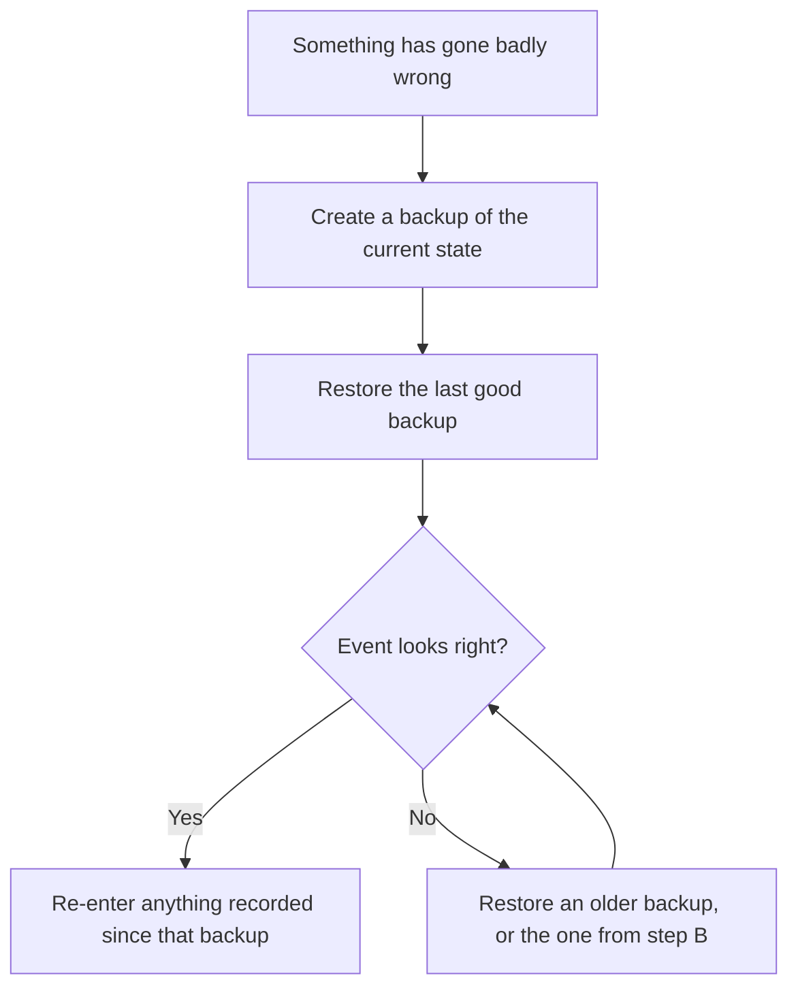

# Backups and restore

TMS backs up the whole event automatically and lets you restore any backup with a couple of clicks. Backups are managed on the **Backups** page, in the side menu. Only an admin can open it.

## What a backup contains

Everything: teams, tables, matches, scoresheets, judging sessions, pods, users and settings. A backup is a complete snapshot of the event at one moment.

Backups are stored as `.zip` files in the `backups` folder next to the server program. The file name includes the date and time it was taken.

## Automatic backups

The server takes a backup on a timer. Both settings are in **Setup → System Setup**.

| Setting | Default | Meaning |
| --- | --- | --- |
| Backup interval | 10 minutes | How often a backup is taken |
| Backups to retain | 5 | How many are kept before the oldest is deleted. `0` keeps them all. |

With the defaults you can always go back to a point within the last ten minutes, and as far back as roughly fifty minutes.

!!! tip "Event day settings"
    Disk space is not a concern for an event of this size. Setting **backups to retain** to `0` on the day keeps every backup, so you can go back to any point in the event.

## Manual backups

Select **Create Backup** to take one immediately. Do this:

- once setup is complete, as your clean starting point,
- before importing a schedule into an event that already has data,
- before restoring or purging, and
- at the end of the event.

## Downloading a backup

Each backup in the list has a download button. Use it to keep a copy somewhere other than the server computer, such as a USB stick. Do this at least at the end of the event.

## Restoring a backup

Restoring replaces the entire current state of the event with the backup.

1. **Create a backup first**, so you can return to where you are now.
2. Find the backup you want in the list and select **Restore**.
3. Confirm.

Every connected device updates to the restored state.

!!! danger "Restoring overwrites the current event"
    Everything entered since the chosen backup was taken is lost: scoresheets, schedule edits, check-ins. Only restore when that is what you intend.

!!! warning "The server may stop during a restore"
    The Backups page carries a caution for a reason. If a backup file is damaged, the database can fail while loading it and the server will stop. If that happens, start the server again and restore a different backup.

## Moving an event to another computer

1. On the old server, create a backup and download it.
2. Install TMS on the new computer and start it.
3. Stop the new server, copy the backup file into its `backups` folder, and start it again.
4. Log in as `admin` (with the default password, since this is a new server) and restore the backup from the **Backups** page.

After the restore, the accounts and passwords are those of the original event.

!!! note
    Restore through the Backups page instead of copying the `tms.kvdb` folder between machines. The server checks the data as it loads it.

## If the server computer fails

The backups are on the server computer, so a dead disk takes them with it. For an event that matters, download a backup to another device at natural breaks, such as lunch and the end of each round. With that file and a spare laptop you can be running again in a few minutes using the steps above.
