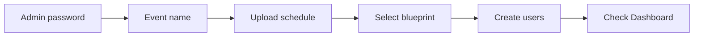

# Event setup

The **Setup** page holds every event-wide setting. Only an admin can open it.

Each row has a send button at its right-hand end. A setting is not saved until you press the button on its row, and a short message confirms the result. All settings can be changed while the event is running, and take effect on every device straight away.

## System Setup

### Event name

A name for the event. Optional.

### Admin password

Sets the password of the `admin` account. Change it from the default `admin` before the event.

!!! danger
    Whoever has the admin password can change scores, restore backups and purge the event.

### Backup interval

How often the server takes an automatic backup, in minutes. The default is **10**.

### Backups to retain

How many backups the server keeps. When the limit is reached the oldest is deleted to make room. The default is **5**. Setting **0** keeps every backup.

See [Backups and restore](backups.md).

## Schedule Setup

### Upload schedule

Choose the schedule CSV file, then press send. See [Schedules](../guides/schedule.md) for where the file comes from and what the import creates.

## Season Setup

### Select Blueprint

Chooses the scoresheet referees use.

- A season, such as `2026-Founders`, gives referees the full scoresheet for that game with automatic scoring and checks.
- **Agnostic** gives referees a single score box.

See [Seasons and games](../guides/seasons.md).

## Game Scoring Setup

### Timer length

The length of a match in seconds. The default is **150** (2:30).

### Endgame length

How many seconds before the end of the match the end-game phase begins, when the clock changes colour and the end-game sound plays. The default is **30**.

See [Match timer](../guides/timer.md).

## Purge

**PURGE** empties the whole database: teams, matches, tables, scoresheets, judging sessions and pods, and also the user accounts and the settings on this page. The server returns to the state of a fresh install, with only the `admin` account and its default password. You are asked to confirm.

Use it to clear a test event before the real one, or to start again after importing the wrong schedule.

!!! danger "This cannot be undone"
    Create a backup first, on the **Backups** page. A backup is the only way back.

## Recommended setup order

1. Change the **admin password**.
2. Set the **event name**.
3. **Upload the schedule**.
4. **Select the blueprint**.
5. [Create user accounts](users.md).
6. Open the **Dashboard** and resolve any [integrity messages](../guides/integrity.md).
7. Create a manual **backup**. This is your clean starting point.
