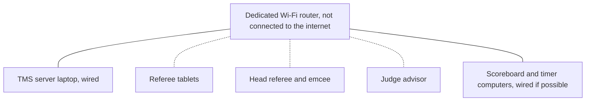

# Network planning

TMS needs one thing from the network: every device must be able to reach the server computer. Most event-day problems are network problems, so it is worth ten minutes of planning.

## The simple, reliable setup



- Bring **your own router**. Venue Wi-Fi is often configured so that devices cannot see each other, which stops TMS working.
- **Wire the server** to the router with a cable. Wire the display computers too if you can.
- Use a **network name and password** only your volunteers have.
- The router does not need an internet connection.

## Requirements

| Requirement | Detail |
| --- | --- |
| Reachability | Every device must be able to open a connection to the server's address and port |
| Port | TCP **8080** by default, or whatever you set with `--port` |
| Protocols | HTTP and WebSocket on that one port, or HTTPS and secure WebSocket with `--tls` |
| Internet | Not required |
| Bandwidth | Very low. A scoresheet is a few kilobytes. |

## Give the server a fixed address

Devices find the server by its IP address. If that address changes during the day, every device loses the server.

Do one of the following:

- In the router's settings, **reserve** an address for the server computer (often called a DHCP reservation or static lease).
- Or set a **static IP address** on the server computer, outside the range the router hands out.

Then write the address on a card for each volunteer, or show the [QR code](../getting-started/connecting.md#sharing-the-address-with-a-qr-code) from the connection page.

## Firewalls

The server computer must accept incoming connections on its port.

=== "Windows"

    Allow `tms_server.exe` when Windows Firewall asks on first run. If you dismissed the prompt, open **Windows Security → Firewall & network protection → Allow an app through firewall** and tick TMS for the network type you are on.

    Set the network to **Private** in Windows network settings. Windows blocks most incoming connections on networks marked Public.

=== "macOS"

    If the firewall is on, allow incoming connections for `tms_server` in **System Settings → Network → Firewall → Options**.

=== "Linux"

    If you use `ufw`:

    ```bash
    sudo ufw allow 8080/tcp
    ```

## Using venue Wi-Fi

If you must use the venue's network, test it beforehand. Ask the venue's IT contact two questions:

1. **Is client isolation turned on?** If it is, devices cannot reach each other and TMS will not work on that network.
2. **Can a device keep the same address all day?**

A quick test: start the server on one device and open its address from a phone on the same Wi-Fi. If the home screen loads, the network is usable.

If the network is shared with the public, run the server with [`--tls`](server-options.md#encryption-tls) and change every default password.

## Keep the server awake

Before the event, on the server computer:

- [ ] Plug in the power supply.
- [ ] Turn off sleep and hibernate, including when the lid closes.
- [ ] Pause automatic updates and restarts for the day.
- [ ] Close anything else that might use the same port.

## Devices that sleep

Tablets drop their connection when they sleep and reconnect when they wake. This is normal: the connection markers appear in the top bar for a moment and then clear. Nothing is lost.

If a device does not reconnect within a few seconds, see [Troubleshooting](../support/troubleshooting.md#the-device-will-not-connect).

## Reaching TMS from outside the venue

By default TMS is only reachable on the local network. To let people off-site view the scoreboard, see [Remote access](remote-access.md).
