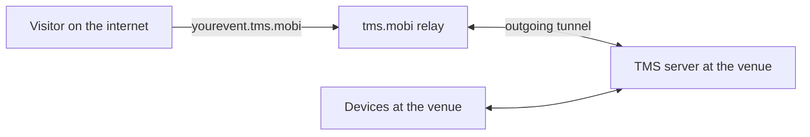

# Remote access

Normally TMS can only be reached from the venue network. Remote access publishes your server at a public web address, so people who are not at the venue can open it, for example parents watching the scoreboard or a remote scorekeeper.

It works through the `tms.mobi` relay service. Your server makes an outgoing connection to the relay, and the relay forwards visitors to it. You do not need to open ports on the venue's router.



## What you need

- An **internet connection** on the server computer.
- A **token** for the relay service, issued by the TMS maintainers. Without a token the relay will not accept your server.
- A **subdomain** name for your event, for example `curtin`.

## Turning it on

Start the server with both options:

```bash
./tms_server --proxy_token YOUR_TOKEN --proxy_domain curtin
```

The first time, the server downloads a small helper program (`frpc`) that runs the tunnel. This needs internet access and takes a few seconds. When the tunnel is up, the server log shows:

```text
Tunnel active: https://curtin.tms.mobi
```

Your event is then available at that address, over HTTPS. Devices at the venue can keep using the local address as before.

!!! note
    Both options are required. If only the token is given, the server logs a warning and starts without the tunnel.

## If the tunnel drops

The server keeps trying to reconnect on its own. Devices on the local network are not affected at all: remote access is an extra path in, not something the event depends on.

## Security

Publishing your server makes it reachable by anyone who knows or guesses the address.

!!! danger "Before you turn on remote access"
    - Change the `admin` password.
    - Change the passwords of every default account, or delete the ones you do not use.
    - Treat the token like a password. Do not share it or commit it to a repository.

Visitors who do not log in can only see the public screens: the scoreboard and the timer. Everything else needs an account.

## When not to use it

- If the venue's internet is unreliable. A tunnel that keeps dropping only confuses people.
- If nobody off-site needs access. A closed local network is simpler and more private.
- For referee tablets at the venue. They should always use the local address, so that scoring never depends on the internet.
