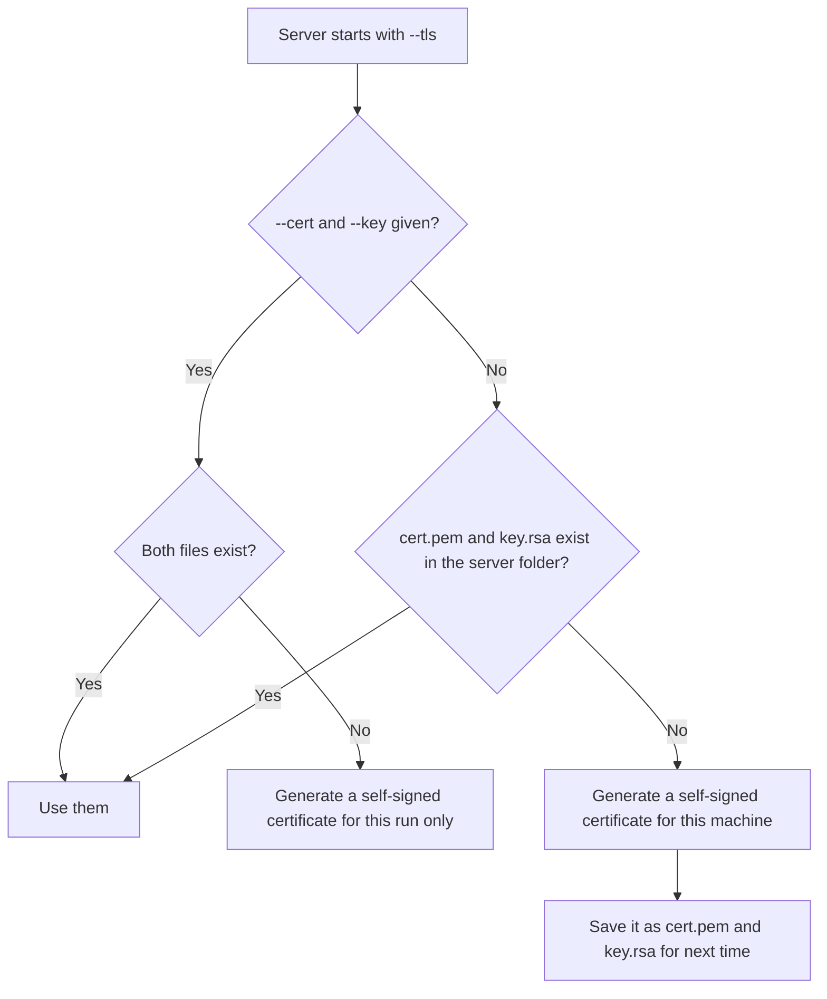

# Server options

The server takes its options on the command line. With no options it listens on every network interface on port 8080 without encryption, which suits most events.

```bash
./tms_server --help
```

## Options

| Option | Default | Meaning |
| --- | --- | --- |
| `--addr <ADDR>` | `0.0.0.0` | The address to listen on. `0.0.0.0` means every network interface. |
| `--port <PORT>` | `8080` | The port to listen on. |
| `--tls` | off | Serve over HTTPS and secure WebSockets instead of HTTP. |
| `--cert <PATH>` | `cert.pem` | The certificate file to use with `--tls`. |
| `--key <PATH>` | `key.rsa` | The private key file to use with `--tls`. |
| `--proxy_token <TOKEN>` | none | Token for the `tms.mobi` remote access service. |
| `--proxy_domain <NAME>` | none | Subdomain to publish the server on, for example `curtin` for `curtin.tms.mobi`. |
| `-h`, `--help` | | Print the options and exit. |

## Examples

=== "Default"

    ```bash
    ./tms_server
    ```

    Reachable at `http://<server address>:8080`.

=== "Different port"

    ```bash
    ./tms_server --port 80
    ```

    Port 80 is the default web port, so people can type just the server's address. On Linux and macOS, ports below 1024 need administrator rights.

=== "Encrypted"

    ```bash
    ./tms_server --tls
    ```

    Reachable at `https://<server address>:8080`.

=== "Your own certificate"

    ```bash
    ./tms_server --tls --cert=fullchain.pem --key=privkey.pem
    ```

## Encryption (TLS)

By default TMS does not encrypt traffic. On a closed event network this is the most compatible choice: every browser and tablet connects without warnings.

Turn on `--tls` when the network is shared with people you do not trust, such as open venue Wi-Fi.

### How certificates are chosen



### Self-signed certificates and browser warnings

A certificate the server generates for itself is not issued by a recognised authority, so browsers show a warning the first time each device connects. On each device, choose to continue to the site.

To avoid the warning you need a certificate that devices already trust, which in practice means a real domain name. For most events it is simpler to run without `--tls` on a private network, or to use [remote access](remote-access.md), which provides HTTPS for you.

!!! note
    The clients try HTTPS first and fall back to HTTP, so they work with either setting without being reconfigured.

## Running as a service

For a permanent installation you may want the server to start with the machine.

=== "Linux (systemd)"

    ```ini title="/etc/systemd/system/tms.service"
    [Unit]
    Description=TMS server
    After=network-online.target

    [Service]
    WorkingDirectory=/opt/tms
    ExecStart=/opt/tms/tms_server --port 8080
    Restart=on-failure

    [Install]
    WantedBy=multi-user.target
    ```

    ```bash
    sudo systemctl enable --now tms
    ```

=== "Docker"

    ```bash
    docker run -d --restart unless-stopped -p 8080:8080 --name tms cjbuchel/tms
    ```

`WorkingDirectory` matters: the server must start in its own folder.
