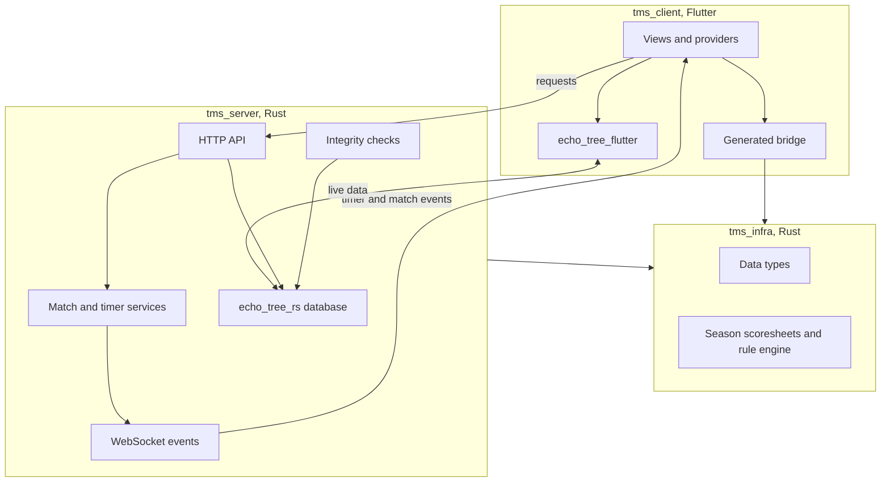
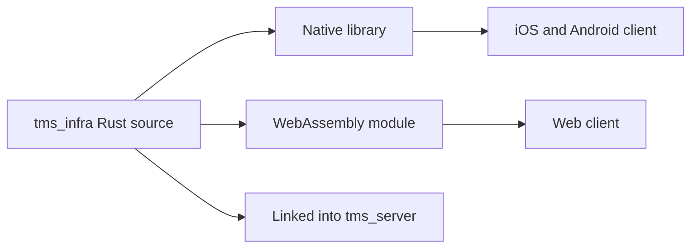
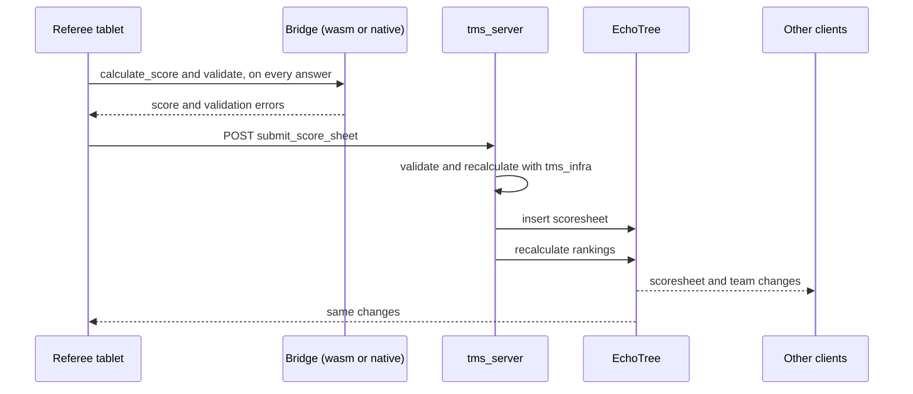

# Architecture

This page is for people working on TMS itself. It explains what the parts are and how data moves between them.

## Repository layout

| Folder | Language | What it is |
| --- | --- | --- |
| `tms_server` | Rust | The server: HTTP and WebSocket API, match and timer services, integrity checks, backups |
| `tms_infra` | Rust | Shared data types, season scoresheets and the scoring rule engine. Used by the server directly and by the client through a bridge. |
| `tms_schedule_handler` | Rust | Schedule CSV parser |
| `echo_tree_rs` | Rust | EchoTree: the embedded database and its live-sync protocol |
| `echo_tree_infra` | Rust | EchoTree protocol types and the schema generator |
| `echo_tree_flutter` | Dart | EchoTree client for Flutter |
| `tms_client` | Dart (Flutter) | The client application for web, iOS and Android |
| `docs` | Markdown | This documentation |
| `azure-pipelines` | YAML | Build and release pipeline |

## The big picture

## One codebase for scoring

The scoresheets and scoring rules live in `tms_infra`, in Rust, and are used in two places:

- the **server** calls them directly to validate and score every submitted sheet, and
- the **client** calls the same code through [flutter_rust_bridge](https://github.com/fzyzcjy/flutter_rust_bridge), compiled to WebAssembly for the web client and to a native library for iOS and Android.

So a score shown on a tablet and the score stored by the server come from the same code. There is no second implementation to keep in step.

The bridge is fully synchronous (`default_dart_async: false` in `tms_client/flutter_rust_bridge.yaml`). That is a deliberate choice: synchronous calls need no worker threads, so the WebAssembly build needs no cross-origin isolation headers and works over plain HTTP.

## Three channels between client and server

| Channel | Used for | Direction |
| --- | --- | --- |
| HTTP requests | Commands: log in, submit a scoresheet, load a match, change a setting | Client to server |
| TMS WebSocket (`/ws/<id>`) | Events: timer ticks, match loaded and ready, table signals | Server to client |
| EchoTree WebSocket (`/echo_tree/ws/<id>`) | Data: the live copy of teams, matches, scores and so on | Both ways |

A client registers over HTTP first and receives an id and token. It sends those as the `X-Client-Id` and `X-Auth-Token` headers on every request.

### EchoTree

EchoTree is a small key-value database (built on [sled](https://github.com/spacejam/sled)) with a subscription protocol on top.

- Data is organised into named **trees**, for example `:teams` or `:robot_game:matches`.
- Each tree has a JSON **schema**, generated from the Rust types, and every write is validated against it.
- **Roles** control which trees an account may read and write.
- A client **subscribes** to the trees a screen needs. The server sends the current contents, then every change as it happens. The client keeps a local copy, so screens read from memory.

This is why the UI needs no refresh: views are built on providers that listen to their trees.

## A scoresheet's journey

## Server services

Match service
:   Holds which matches are loaded and ready, runs the timer, and publishes timer and match events to every client. When the timer finishes it marks the loaded matches complete.

Integrity service
:   Re-checks the event data on a schedule and writes its findings to the integrity messages tree, which the Dashboard and other screens subscribe to.

Backup service
:   Takes a backup on the configured interval and prunes old ones.

## Client structure

| Folder in `tms_client/lib` | Contents |
| --- | --- |
| `views` | One folder per screen |
| `widgets` | Shared widgets, including the scoresheet renderer |
| `providers` | State, one provider per area of data, built on EchoTree subscriptions |
| `services` | HTTP calls to the server |
| `network` | Connection handling: HTTP, WebSocket, EchoTree, and the connectivity state shown in the top bar |
| `generated` | Bridge code generated from `tms_infra`. Never edit by hand. |

Routing is in `lib/router.dart`. Which screens a role sees is decided in two places that must agree: the client (home screen and side menu) and the server (the role filter on each route).
