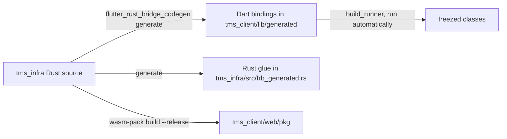

# Building from source

## Tools

| Tool | Version | Used for |
| --- | --- | --- |
| [Rust](https://rustup.rs) | Current stable | Server and shared code |
| Rust `1.99.0` | Pinned in `tms_infra/rust-toolchain.toml` | Client native library and WebAssembly builds. `rustup` installs it automatically. |
| [Flutter](https://docs.flutter.dev/get-started/install) | `3.47.7` | Client |
| [flutter_rust_bridge_codegen](https://github.com/fzyzcjy/flutter_rust_bridge) | `2.13.0` | Generating the Dart bindings |
| [wasm-pack](https://rustwasm.github.io/wasm-pack/) | Current | Building the WebAssembly module |

```bash
cargo install flutter_rust_bridge_codegen --version 2.13.0
cargo install wasm-pack
```

!!! note "Why two Rust versions?"
    The Flutter build hook that compiles `tms_infra` for mobile requires an exact, pinned toolchain so that builds are reproducible. The pin only applies to commands run from inside `tms_infra`. The server builds from the workspace root on your normal stable toolchain.

## Quick build

```bash
# 1. generate the bridge code and build the wasm module
./run_codegen

# 2. build the web client
cd tms_client
flutter build web
cd ..

# 3. run the server, which hosts tms_client/build/web
cargo run -p tms_server
```

Then open `http://localhost:8080`.

## What `run_codegen` does



1. **`flutter_rust_bridge_codegen generate`** reads `tms_infra` and writes the Dart bindings and the Rust glue. It also runs `build_runner` for the generated freezed classes, so there is no separate step for that.
2. **`wasm-pack build`** compiles `tms_infra` to WebAssembly for the web client.

Run it whenever you change anything in `tms_infra` that the client can see: a data type, a season, or a function.

!!! info "Why not `flutter_rust_bridge_codegen build-web`?"
    That command builds a threaded WebAssembly module, which needs a nightly toolchain and cross-origin isolation headers. TMS's bridge is fully synchronous and never uses threads, so a plain stable `wasm-pack` build is all it needs. The result is smaller and works over plain HTTP.

## Building each part

=== "Server"

    ```bash
    cargo build -p tms_server --release
    ```

    The binary is `target/release/tms_server`. It expects to be run from a folder that contains `log_config` and `tms_client/build/web`. From the repository root that is already true.

=== "Web client"

    ```bash
    ./run_codegen
    cd tms_client && flutter build web
    ```

    Output is `tms_client/build/web`, which the server hosts at `/ui`.

=== "Android"

    ```bash
    cd tms_client && flutter build apk
    ```

    The Rust library is compiled for each Android ABI by the build hook in `tms_client/hook/build.dart`. The Android NDK is required.

=== "iOS"

    ```bash
    cd tms_client && flutter build ipa
    ```

    Requires macOS and Xcode. The same build hook compiles the Rust library.

=== "Docker"

    The `Dockerfile` packages a prebuilt Linux (musl) server binary with the web client. Build those first, then:

    ```bash
    docker build -t tms .
    ```

## How the Rust library reaches the client

Native platforms use Flutter's **native assets**: `tms_client/hook/build.dart` tells Flutter to build the crate at `../tms_infra` and bundle the result into the app. There is no separate plugin package and nothing to run by hand.

The web client loads the WebAssembly module from `web/pkg`, which `run_codegen` produces.

## Developing

Run the server, then run the client with hot reload against it:

```bash
cargo run -p tms_server
```

```bash
cd tms_client
flutter run -d chrome
```

A client started this way is not hosted by the server, so use its connection page to point it at `localhost` and port `8080`.

!!! tip
    `flutter_rust_bridge_codegen generate --watch` regenerates the bindings each time you save a Rust file.

## Things that are generated

Do not edit these by hand; regenerate them.

| Path | Regenerate with |
| --- | --- |
| `tms_client/lib/generated/**` | `./run_codegen` |
| `tms_infra/src/frb_generated.rs` | `./run_codegen` |
| `tms_client/web/pkg/**` | `./run_codegen` |
| `echo_tree_flutter/rust_schemas/echoTreeSchema.json` | Any build of `echo_tree_infra` |

## Hiding Rust items from the bridge

Everything public under `tms_infra::infra` is exposed to Dart by default. Mark items that only the server needs so that no bindings are generated for them:

```rust
#[flutter_rust_bridge::frb(ignore)]
fn to_schema() -> String { /* server only */ }
```

The season structs and the JSON schema functions are already marked this way.

## Continuous integration

The GitHub Actions workflow in `.github/workflows/ci.yml` generates the bindings, builds the wasm module, builds the client for each platform and the server for each operating system, and publishes release artefacts. The Flutter and codegen versions it installs are pinned in the `env` block at the top of that file. Keep them in step with the versions on this page.

Pushes to `master` and `ci-cd` also release: a **draft** GitHub release for the version in `vars.yml`, the Docker image, and the TestFlight build. The draft is published by hand. Once a version is published, later pushes build but do not release until `tms_version` is bumped.

This documentation is built by `.github/workflows/gh-pages.yml` with `mkdocs build` and published to GitHub Pages on pushes to `master`.

To preview it locally:

```bash
pip install mkdocs-material
mkdocs serve
```
