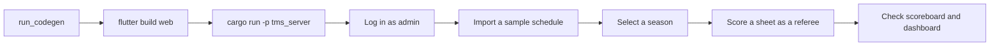

# Testing and quality checks

Run these before opening a pull request. They are quick, and they are what keeps the project clean.

## The short version

```bash
# Rust
cargo clippy --workspace --all-targets -- -D warnings
cargo test --workspace

# Dart
cd tms_client
flutter analyze
flutter test
cd ../echo_tree_flutter
flutter analyze
```

All of them should finish with no warnings and no failures.

## Rust

### Lints

```bash
cargo clippy --workspace --all-targets -- -D warnings
```

The workspace is kept free of clippy warnings, so `-D warnings` turns any new one into a failure. A small number of lints are silenced with `#[allow(...)]` at the exact place they apply, with the reason obvious from context. Prefer fixing a lint to silencing it.

### Tests

| Test | What it covers |
| --- | --- |
| `tms_infra/tests/fll_scoring.rs` | Scoring and validation for each season: defaults, every rule, every check, maximum scores, and that mission images exist |
| `echo_tree_rs` `backup_manager` tests | That a backup survives being written and read back |

```bash
cargo test --workspace
```

## Dart

### Analyzer

```bash
flutter analyze
```

Lint rules come from `flutter_lints`, configured in `analysis_options.yaml`. Generated code under `lib/generated` is excluded from linting.

Because it is excluded, also check the generated code for real errors after regenerating the bridge:

```bash
dart analyze lib/generated | grep "error -"
```

No output means no errors.

### Bridge tests

`tms_client/test/bridge_test.dart` calls the Rust code through the bridge, natively. It checks that the seasons are present, that default answers score and validate correctly, that 2026 mission images exist, and that JSON survives a round trip.

It needs the host library, so build that first:

```bash
cargo build -p tms_infra --release
cd tms_client
flutter test
```

If the library has not been built, the tests are skipped with a message saying so.

## Checking the whole thing by hand

Automated tests do not cover the user interface. After any change that touches the client or the API, run a short end-to-end check.



Sample schedules are in `test_imports/`:

| File | Use |
| --- | --- |
| `single_day.csv` | A normal single-day event |
| `multi_day.csv` | A multi-day event with practice matches |
| `broken_single_day.csv` | A schedule with deliberate mistakes, for exercising the integrity checks |

A reasonable smoke test:

- [ ] Home screen loads and the connection markers clear
- [ ] Log in as `admin`
- [ ] Import `single_day.csv`; the Dashboard shows the matches and no errors
- [ ] Select a season; **Referee Scoring** shows that season's scoresheet with images
- [ ] Load, ready and start a match from the **Match Controller**; the timer runs on the public **Timer** screen
- [ ] Submit a scoresheet; the **Scoreboard** updates
- [ ] Submit an impossible scoresheet; it is rejected with a message
- [ ] Create and restore a backup

## When you change a dependency

- **`flutter_rust_bridge`**: the crate version in `tms_infra/Cargo.toml`, the package version in `tms_client/pubspec.yaml`, the installed `flutter_rust_bridge_codegen`, and the pipeline's pinned version must all be the same.
- **`bincode`**: the backup format depends on it. A change of version or configuration makes existing backup files unreadable.
- **`freezed`**: regenerate the bridge and check `lib/generated` for errors, since the generated classes depend on it.
- **Anything in `tms_infra`**: run `./run_codegen`, because the client is built from it.
