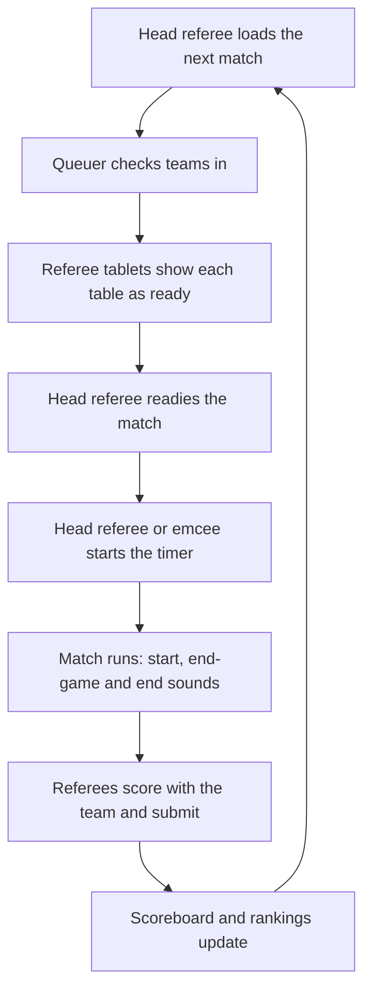

# Event day walkthrough

This page shows how the roles fit together across a typical day. Each role has its own detailed guide; this is the overview you can use for a volunteer briefing.

## Before teams arrive

| Who | What |
| --- | --- |
| Event administrator | Start the server, import the schedule, choose the season, create accounts. See the [quick start](quick-start.md). |
| Event administrator | Open the **Dashboard** and clear any integrity messages. |
| Screen and AV operator | Put the **Scoreboard** and **Timer** on the venue screens, assign each timer to its tables, and connect one timer computer to the sound system. |
| Head referee | Check the **Tables** and **Matches** pages match the room. |
| Referees | Log in on each tablet, open **Referee Scoring**, select the table and enter a referee name. |
| Judge advisor | Check **Judging Sessions** and **Pods**. |

## Running a match

1. The **head referee** loads the match in the **Match Controller**. The teams appear on each referee's tablet and on the emcee's **Match Announcer**.
2. The **queuer** checks each team in as it arrives at its table.
3. Each **referee** has **Referee Scoring** open on their table. The tablet reports to the head referee automatically, so the Match Controller shows each table as ready.
4. The **head referee** readies the match, then starts the timer, either immediately or with a countdown.
5. When the timer reaches zero the match is marked complete.
6. Each **referee** completes the scoresheet with the team and submits it, and the **scoreboard** updates.

## During the day

- The **judge advisor** watches the **Teams** and **Team Data** pages, corrects any scores that were entered wrongly, and keeps judging sessions up to date.
- The **event administrator** keeps an eye on the **Dashboard**. New integrity messages mean something needs attention, for example a match marked complete with no score.
- The server takes a backup every ten minutes by default.

## When something changes

Schedules change. TMS is built for that:

- A team is late or swaps a slot: the head referee can **reschedule** a team to another match from the Match Controller, or edit the match on the **Matches** page.
- A table breaks: the head referee can move teams to another table, or remove the table.
- A score was entered against the wrong team or round: the judge advisor can edit or delete the scoresheet from the **Teams** page.
- A team withdraws: the referee submits a **No Show** for that round.

## At the end of the day

1. The judge advisor exports the results from **Team Data**.
2. The event administrator creates a final backup from the **Backups** page and downloads it.
3. Stop the server. Keep the server folder, or at least the downloaded backup, as your record of the event.
