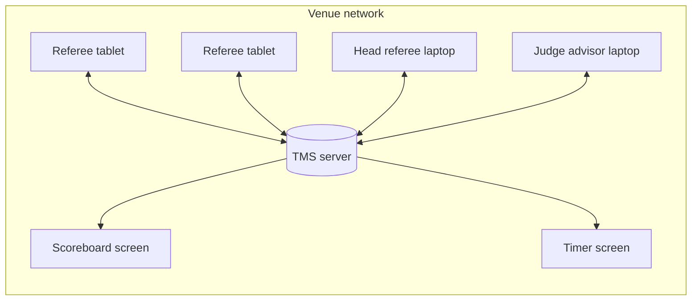
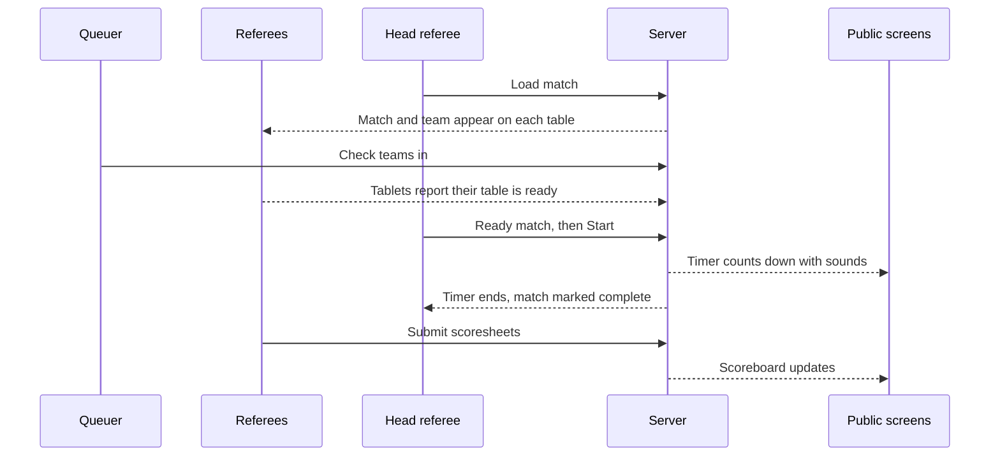

# How TMS works

TMS has two parts: one **server** and any number of **clients**.

The server is a single program that you run on a laptop or small computer at the venue. It stores the event, enforces who is allowed to do what, calculates scores and rankings, and sends every change to every connected device straight away.

A client is what people actually use. It is the same application everywhere: in a web browser, or as the tablet app. What a person sees depends on the account they log in with.

## Key ideas

Everything is live
:   There is no refresh button. When a referee submits a score, the scoreboard, the dashboard and the team pages update on their own within a moment.

The server is the source of truth
:   Devices show a copy of the event. If a tablet loses its connection it reconnects and catches up. Scores are calculated and checked again on the server, so a device cannot submit an invalid scoresheet.

Roles decide what you can do
:   Each account has one or more roles such as referee or judge advisor. The home screen and the side menu only show the screens that role is allowed to use. See [Roles at a glance](../roles/index.md).

No internet required
:   Clients talk to the server over the local network. Internet access is only needed to download TMS in the first place, or if you choose to use [remote access](../admin/remote-access.md).

## The pieces of an event

| Piece | What it is | Who looks after it |
| --- | --- | --- |
| Teams | Team number, name and affiliation | Judge advisor |
| Tables | The robot game tables, by name | Head referee |
| Matches | Which teams play on which tables, and when | Head referee |
| Scoresheets | One per team per round, submitted by a referee | Referees, corrected by the judge advisor |
| Judging pods | The judging rooms, by name | Judge advisor |
| Judging sessions | Which teams are in which pod, and when | Judge advisor |
| Season | Which game's scoresheet the referees see | Event administrator |

Most of this arrives in one step when the administrator [imports the schedule file](../guides/schedule.md).

## The public screens

Two screens need no login and are designed to be left running on a projector or television:

- the **Scoreboard**, which shows team rankings and scores per round, and
- the **Timer**, which shows the match clock and plays the start, end-game and end sounds.

See the [Screen and AV operator guide](../roles/av-operator.md).

## A match from start to finish

Next: [set up an event](quick-start.md).
