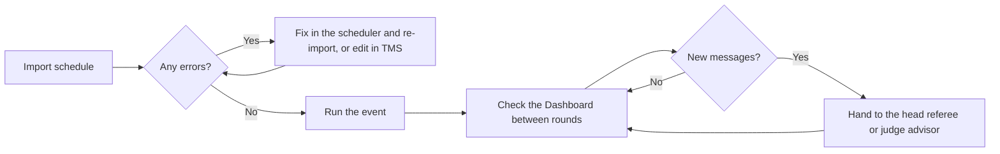

# Integrity checks

TMS continuously checks the event data for mistakes: a team scheduled twice, a score that was never submitted, a match on a table that does not exist. Anything it finds is shown as an **integrity message** with a code.

## Where messages appear

| Screen | Shows |
| --- | --- |
| **Dashboard** | Every message for the whole event |
| **Matches** | An icon on each match with a problem, and counts in the banner |
| **Teams** | The issues for the selected team |
| **Judging Sessions** | An icon on each session with a problem, and counts in the banner |

The server re-checks the event every ten seconds. Messages clear by themselves when the cause is fixed.

## Errors and warnings

Errors (`E`)
:   Something is wrong and will affect results or the running of the event. Fix these.

Warnings (`W`)
:   Something looks unusual. Many warnings are normal for a short time during the day, such as a match that has just finished and has not been scored yet.

## Errors

| Code | Message | What to do |
| --- | --- | --- |
| `E001` | Team number is missing | Give the team a number on the **Teams** page. |
| `E002` | Duplicate team number | Two teams share a number. Correct or delete one. |
| `E003` | Team has conflicting scores | A team has two scoresheets for one round. The judge advisor deletes or re-rounds one. |
| `E004` | Table does not exist in event | A match uses a table name that is not on the **Tables** page. Add the table or fix the match. |
| `E005` | Team in match does not exist in this event | A match lists a team number that is not on the **Teams** page. Fix the match or add the team. |
| `E006` | Duplicate match number | Two matches share a number. Renumber one. |
| `E007` | Team has fewer matches than the maximum number of rounds | One team is scheduled for fewer matches than the others. Add it to a match. |
| `E008` | Pod does not exist in event | A session uses a pod name that is not on the **Pods** page. |
| `E009` | Team in pod does not exist in this event | A session lists a team number that is not on the **Teams** page. |
| `E010` | Team has more than one judging session | Remove the team from the extra session. |
| `E011` | Team is not in any judging sessions | Add the team to a session. |
| `E012` | Duplicate session number | Renumber one of the sessions. |
| `E013` | Team has match overlapping with judging session | Move the match or the session. |
| `E000` | Unknown error | Check the server log and report it. |

## Warnings

| Code | Message | What it usually means |
| --- | --- | --- |
| `W001` | Team name is missing | The team has a number but no name. |
| `W002` | Duplicate team name | Two teams have the same name. Often fine. |
| `W003` | Team has a round 0 score | A scoresheet was submitted without a real round. Move it to the right round. |
| `W004` | No tables or teams found in match | An empty match. Delete it or fill it in. |
| `W005` | Match is complete but score not submitted | A referee has not submitted yet, or a no-show was not recorded. |
| `W006` | Match is not complete but score submitted | A score exists for a match that was never run on the timer. Mark the match completed if it was played. |
| `W007` | Blank table in match | A match has a team with no table name. |
| `W008` | No team on table | A table in a match has no team. |
| `W009` | Team has judging session within 10 minutes of match | A tight turnaround. Warn the team or move one of them. |
| `W010` | No pods or teams found in sessions | An empty session. |
| `W011` | Session complete, but no core values score submitted | The Core Values tick is missing for a finished session. |
| `W012` | Session complete, but no innovation score submitted | The Innovation tick is missing for a finished session. |
| `W013` | Session complete, but no robot design score submitted | The Robot Design tick is missing for a finished session. |
| `W014` | Session not complete, but core values score submitted | A rubric was ticked for a session that has not happened yet. |
| `W015` | Session not complete, but innovation score submitted | As above, for Innovation. |
| `W016` | Session not complete, but robot design score submitted | As above, for Robot Design. |
| `W017` | Blank pod in session | A session has a team with no pod name. |
| `W018` | No team in pod | A pod in a session has no team. |
| `W000` | Unknown warning | Check the server log and report it. |

## A sensible routine

- **After importing**, there should be no errors. Errors at this point come from the schedule itself.
- **During the day**, expect `W005` to appear briefly after each match and clear as referees submit.
- **At the end of the day**, there should be no `E003`, `W005` or `W006` left. If there are, results may be incomplete.
