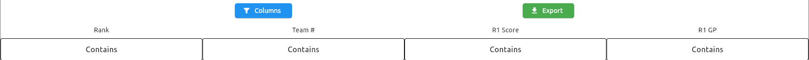

# Judge Advisor

Our reccommended usage is for a Judge Advisor (JA) to have access to their own device (with OJS excel) and a JA login for TMS.

The JA has little to do with TMS until deliberations, as currently the only TMS functionality for judging is the export/download of robot game + GP scores. 

---

## **Export Button** 
Clicking the export button will download a .csv with the import for the OJS.
By default, the formatting of the exported file can be copy/pasted directly into the Official Judging Spreadsheet (OJS).

!!! warning "The data contained in the export, is the data currently visible"
    If you are using the following filtering features, the filters will be reflected in the export.

---

## **Columns Button**
Clicking the Columns button presents you with the following options to be included in the data:

| Option      | Description                          |
| ----------- | ------------------------------------ |
| `rank`             | Data on a team's relative position |
| `teamNumber`       | A team's FIRST Lego League team number |
| `teamName`         | Team Name at the event |
| `R#_score`         | The team's robot game score in round # |
| `R#_gp`            | The team's GP score in round # |
| `R#_comment`       | A comment left by referees (usually on why a GP score has been altered) |

The default options (an options required to import into OJS) are rank, team number, rounds scores, and GP scores. 

---

## **Contains**
At the top of each column there is a field to filter the column by `contains`. By clicking on this field and entering a value, only rows with that data contained will be displayed. 
