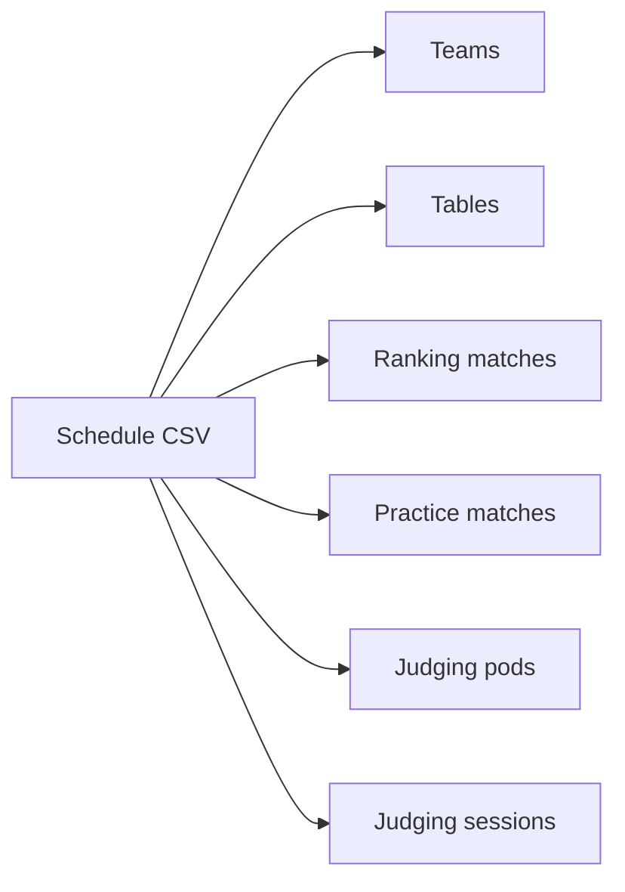

# Schedules

TMS takes its teams, tables, matches, judging pods and judging sessions from one schedule file. After the import, everything can be edited by hand.

## Where the file comes from

TMS reads the CSV file produced by the FLL tournament scheduler used by *FIRST* Australia: the [FLL Scheduler](https://firstaustralia.org/fll-scheduler/). Build your schedule there and export it.

## Importing

1. Log in as an admin and open **Setup**.
2. Under **Schedule Setup**, select **Select Schedule (CSV)** and choose the file.
3. Press the send button on that row.

A confirmation appears when the import succeeds. Then open the **Dashboard** and check the **Integrity Messages** panel.

!!! warning "Importing again"
    Importing a schedule into an event that already has data merges the file into what is there. It does not remove teams, matches or sessions that are missing from the new file. To replace a schedule completely, take a backup, **Purge** the event in Setup, then import the new file.

## What the import creates



| From the file | Becomes in TMS |
| --- | --- |
| Team list | **Teams**, with number, name and affiliation |
| Table names | **Tables** |
| Ranking matches | **Matches** in the *Ranking Matches* category |
| Practice matches, if present | **Matches** in the *Practice Matches* category |
| Room names | **Pods** |
| Judging time slots | **Judging sessions** |

## The file format

You do not normally need to edit the file, but it helps to know its shape when an import fails. It is a plain CSV file made of numbered blocks.

```text title="schedule.csv (shortened)"
Version Number,1
Block Format,1
Number of Teams,40
1,Orion,Ardross Primary School,
2,TIE-Dye FIGHTERS,Atwell College,
...
Block Format,2
Number of Ranking Matches,60
Number of Tables,6
Number of Teams per Table,2
Number of Simultaneous Tables,1
Table Names,Red,Blue,Pink,Yellow,Green,Black,
1,10:00:00 AM,10:04:00 AM,10,28,,,,,
2,10:07:00 AM,10:11:00 AM,,,18,2,,,
...
Block Format,3
Number of Judged Events,1
Number of Event Time Slots,4
Number of Judging Teams,10
Event Name,Judging
Room Names,Pod 1,Pod 2,Pod 3,
1,10:30:00 AM,11:00:00 AM,18,27,40,
...
```

| Block | Contents | Row format |
| --- | --- | --- |
| `1` | Teams | Team number, team name, affiliation |
| `2` | Ranking matches | Match number, start time, end time, then one team number per table in the order of **Table Names**. An empty cell means that table is not used in the match. |
| `3` | Judging | Session number, start time, end time, then one team number per room in the order of **Room Names** |
| `4` | Practice matches (optional) | Same as block 2 |

Rules the importer applies:

- The first line must be `Version Number,1`.
- Times must be written as `HH:MM:SS`. They are read as 24-hour times; the `AM` or `PM` after them is ignored. Write two in the afternoon as `14:00:00`.
- For multi-day events the scheduler puts the day in front of the time. TMS keeps that text as the match's sub-category so each day's matches stay together.

## Editing after import

| To change | Who | Where |
| --- | --- | --- |
| A team's name or affiliation | Judge advisor | **Teams** |
| Add or remove a team | Judge advisor | **Teams** |
| A match's time, tables or teams | Head referee | **Matches**, or the row actions in **Match Controller** |
| Move one team to another match | Head referee | **Match Controller → Reschedule** |
| Add, rename or remove a table | Head referee | **Tables** |
| A session's time or teams | Judge advisor | **Judging Sessions** |
| Add, rename or remove a pod | Judge advisor | **Pods** |

Every change is live on every device.

## After any change

Check the integrity messages. They exist to catch exactly the mistakes that hand edits cause: a team in two places at once, a team with one match too few, or a match on a table that no longer exists. See [Integrity checks](integrity.md).

## If the import fails

??? failure "Invalid version or unknown CSV type"
    The file does not start with `Version Number,1`. Make sure you exported the schedule itself and not a report, and that the file was not re-saved by a spreadsheet program in another format.

??? failure "The import succeeds but times are wrong"
    Times are read as 24-hour. An afternoon match written as `02:00:00 PM` is read as two in the morning. Re-export from the scheduler, which writes 24-hour times.

??? failure "Teams or tables are missing"
    The counts at the top of each block (`Number of Teams`, `Number of Tables`) must match the rows and names that follow. A file edited by hand often leaves these out of step.
