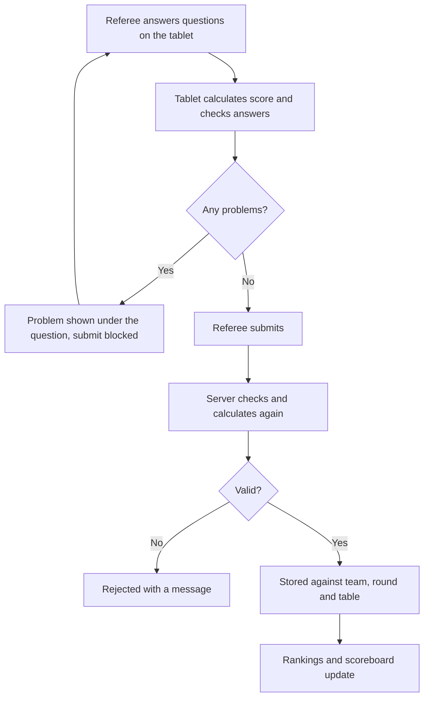

# Scoring and scoresheets

This page explains how scoring works in TMS for anyone who needs more than the [referee guide](../roles/referee.md): how scoresheets are built, how scores are calculated and checked, and how they are corrected.

## Two ways to score

The event administrator chooses how referees score in **Setup → Season Setup**.

Season scoresheet
:   Referees answer the questions on the season's official scoresheet. TMS calculates the score and checks the answers. This is the normal choice.

Agnostic
:   Referees type in the final score. Nothing is calculated or checked. Use this for off-season events or games TMS does not have a scoresheet for.

The available seasons are listed in [Seasons and games](seasons.md).

## The life of a scoresheet

The server never trusts the score a device sends. It recalculates the score from the answers and runs the same checks, so every device and the server always agree.

## What a scoresheet records

| Field | Where it comes from |
| --- | --- |
| Team | The team scheduled on the referee's table in the loaded match |
| Round | The team's round, from the schedule |
| Match number | The loaded match |
| Table | The table the referee selected |
| Referee | The name the referee entered |
| Answers | One per question |
| Score | Calculated from the answers |
| Gracious Professionalism | 2 - Developing, 3 - Accomplished or 4 - Exceeds |
| Private comment | Free text, seen by event staff only |
| No show | Whether the team did not play |
| Timestamp | When it was submitted |
| Modified by | Set if the sheet was later corrected |

## Questions

Each mission on the scoresheet has one or more questions. Every question has a fixed list of answers and a default.

- **Yes / No** questions and short lists are shown as buttons.
- **Number ranges with more than eight options**, such as "how many, from 0 to 50", are shown as a counter with **−1** and **+1** buttons. Ranges longer than twenty also get **−5** and **+5**.

Defaults are chosen so that an untouched scoresheet is the score of a robot that never left base. For example, precision tokens default to all remaining, and "is the model still in its starting position" defaults to yes.

## How a score is calculated

Most answers are simply worth a number of points. Some depend on other answers:

- a **bonus** that only counts if the main part of the mission was achieved,
- a mission that scores **nothing** if a condition is broken, or
- a count that is **capped** by another count.

TMS applies these rules for you. If you select a bonus without its condition, you get no points for it and a message explains why.

## Checks

A scoresheet cannot be submitted while it breaks one of the season's rules. Typical checks:

- **Dependent answers**: a bonus is selected but the thing it depends on is not.
- **Impossible counts**: more objects are recorded in a scoring area than were ever released onto the field.
- **Missing answers**: a question has no answer.

The message is shown in red under the question it relates to.

!!! info "Gracious Professionalism comments"
    Any rating other than *3 - Accomplished* needs a private comment before the sheet can be submitted, so that the judges know why.

## No shows

A referee uses **No Show** when a team does not play a round. The sheet is stored with a score of zero and flagged as a no-show. This keeps the event complete: the round is not reported as a missing score.

## Agnostic scoring

In agnostic mode the scoresheet is a single **Score** box and a **private comment**. The score is stored exactly as entered. Rankings, the scoreboard and the integrity checks work in the same way.

## Correcting scores

Only a **judge advisor** (or an admin) can change a submitted scoresheet, from the team's page under **Teams**. They can:

- edit the answers, round, table, referee or match number,
- mark or unmark a no-show,
- delete the sheet, or
- add a sheet by hand.

Edited sheets are recalculated and checked like any other, and record who changed them. See the [judge advisor guide](../roles/judge-advisor.md#correcting-a-scoresheet).

## Conflicting scores

If a team has more than one scoresheet for the same round, TMS cannot know which is right. It:

- shows **Conflict** for that round on the scoreboard, and
- raises error `E003` on the Dashboard and the team's page.

The judge advisor resolves it by deleting the wrong sheet or moving it to the correct round.
