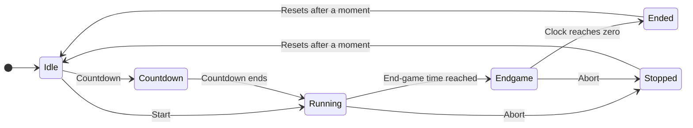

# Match timer

There is one match timer for the whole event. The server runs it, and every device shows the same clock.

## Who can do what

| Action | Head referee | Emcee |
| --- | :---: | :---: |
| Start the match | :material-check: | :material-check: |
| Start with a countdown | :material-check: | :material-check: |
| Abort a running match | :material-check: | |

The timer can only be started when a match is **loaded** and **ready**. See the [head referee guide](../roles/head-referee.md#running-a-match).

## Timer phases

| Phase | What you see and hear |
| --- | --- |
| Idle | The clock shows the full match length |
| Countdown | A short countdown, with a beep each second |
| Running | The clock counts down. A **start** sound plays at the beginning. |
| End-game | The clock changes colour. An **end-game** sound plays once. |
| Ended | The clock is at zero. An **end** sound plays. The loaded matches are marked complete and unloaded. |
| Stopped | The head referee aborted. A **stop** sound plays. The match is not marked complete and stays ready. |

## Settings

Set by the event administrator in **Setup → Game Scoring Setup**.

| Setting | Default | Meaning |
| --- | --- | --- |
| Timer length | 150 seconds | The length of a match (2:30) |
| Endgame length | 30 seconds | How long before the end the end-game phase begins |

Changes apply from the next match.

## Where the timer appears

| Screen | Shows the clock | Plays the sounds |
| --- | :---: | :---: |
| Timer (public) | :material-check: | :material-check: |
| Scoreboard (public), with the match schedule shown | :material-check: | |
| Match Controller | :material-check: | :material-check: |
| Match Announcer | :material-check: | :material-check: |
| Dashboard | :material-check: | :material-check: |

!!! tip "Getting sound into the room"
    Connect one computer showing the Timer to the sound system. Every other device that has a sound-playing screen open will play the sounds too, so mute those, or the room hears each sound several times.

!!! warning "Browsers and automatic sound"
    Browsers do not play sound on a page until someone has clicked or tapped on it, and may stop again if the page is left untouched for a long time.

    Interact with the page once after opening it. For a device that will play sound all day in Chrome or Edge, also allow sound permanently: select the icon to the left of the address, open **Site settings**, and set **Sound** to **Allow**. This is remembered per server address.

## If the timer and the room disagree

Every device counts from messages sent by the server once a second, so screens stay in step even on a slow network. A device that was disconnected during a match shows the correct time as soon as it reconnects.

If a screen is frozen, reload the page. This never affects the match itself; the timer runs on the server.
