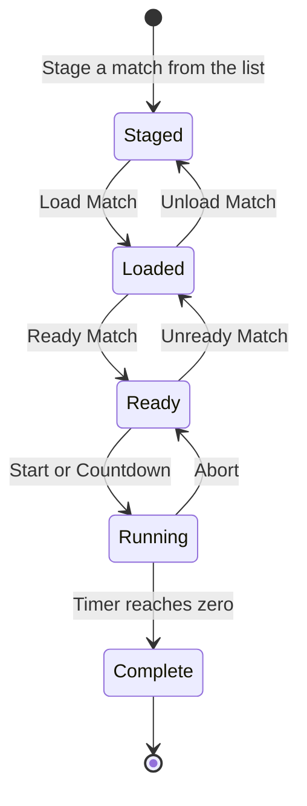

# I am a head referee

You run the robot game: you decide which match is on, start the timer, and keep the match schedule and tables correct. A head referee account can also do everything a referee and a queuer can.

!!! abstract "Your screens"
    **Match Controller**, **Matches**, **Tables**, **Match Announcer**, **Referee Scoring** and **Queueing**.

## The Match Controller

The Match Controller is one screen split in two.

- On the **right** is the match schedule in order. Each row shows the match number, start time, and the team on each table.
- On the **left** are the staged match, the schedule clock, the match timer and the controls.

### Running a match

1. **Stage** the match. Open a match row with the arrow on its right and select the blue stage button. The match and its tables appear on the left.
2. **Load Match**. The match is now live for everyone: referees see their team, the emcee sees the line-up, and the timer screens show the match.
3. Check the **table status** next to each table (see below).
4. **Ready Match** when the tables are set and teams are in place. This unlocks the timer buttons.
5. **Start** begins the match immediately. **Countdown** plays a short countdown first, then starts.
6. When the timer reaches zero the match is marked complete. Stage the next one.

Use **Abort** to stop a running timer, for example after a false start. The match is not marked complete, so you can start it again.

### Table status

Each table in the loaded match shows a status that comes from the referee's tablet.

| Status | Colour | Meaning |
| --- | --- | --- |
| `SIG` | Red | No tablet is scoring on this table. Nobody has Referee Scoring open with this table selected. |
| `STBY` | Amber | A tablet is on this table but is not showing this match's team yet, usually because the previous scoresheet has not been submitted. |
| `RDY` | Green | A tablet is on this table and is showing the right team. |

You can ready and start a match whatever the statuses say. They are there to tell you whether the referees are with you.

### Single and Multi

The switch above the schedule chooses how many matches you stage at once.

- **Single** stages one match.
- **Multi** lets you stage several matches and run them together on one timer. Use this when the schedule runs matches on different tables at the same time.

### The schedule clock

The red or green clock above the timer shows how far the event is from the next scheduled match start. Negative and red means you are running behind schedule.

### Fixing a match on the spot

Open a match row to reveal four buttons.

| Button | What it does |
| --- | --- |
| Stage (blue) | Stages the match for loading |
| Reschedule (purple) | Moves one team from this match to another match and table |
| Edit (orange) | Opens the match editor |
| Delete (red) | Deletes the match |

To **reschedule a team**, choose the team, then the match to move it to, then the table it will play on, and confirm.

## Matches

The **Matches** page lists every match with its integrity status, start time and tables. Use it for changes that are easier with the whole schedule in view.

- **Add match** creates a new match.
- The pencil on a row opens the **match editor**, where you can change the match number and start time, mark it completed, and add, change or remove the teams on each table.
- The bin on a row deletes the match.

The banner at the top shows how many matches are complete and how many match and team issues the integrity checks have found. A row with a warning or error icon has a problem; see [Integrity checks](../guides/integrity.md).

!!! tip "Replaying a match"
    If a match must be replayed, open the match editor, clear **Completed**, and run it again from the Match Controller. Ask the judge advisor to remove the scoresheets from the first attempt.

## Tables

The **Tables** page lists the robot game tables. You can add a table, rename one, or delete one. Table names must match the names used in the matches.

## Starting the timer from the announcer screen

The **Match Announcer** screen has the same Start and Countdown buttons. If your emcee starts matches, you only need to load and ready them. See the [Emcee guide](emcee.md).

## Common situations

??? question "A referee's table shows SIG"
    Their tablet is not on Referee Scoring, has no table selected, or has lost its connection. Ask them to open Referee Scoring and select their table.

??? question "A team is at the wrong table"
    Either move the team in the match editor, or ask the referees to swap tablets' selected tables. The scoresheet is recorded against the table the referee has selected.

??? question "I loaded the wrong match"
    Select **Unload Match**, then stage and load the correct one. Nothing is recorded until the timer finishes.

??? question "The timer was started by mistake"
    Select **Abort**. The match stays ready and is not marked complete.
