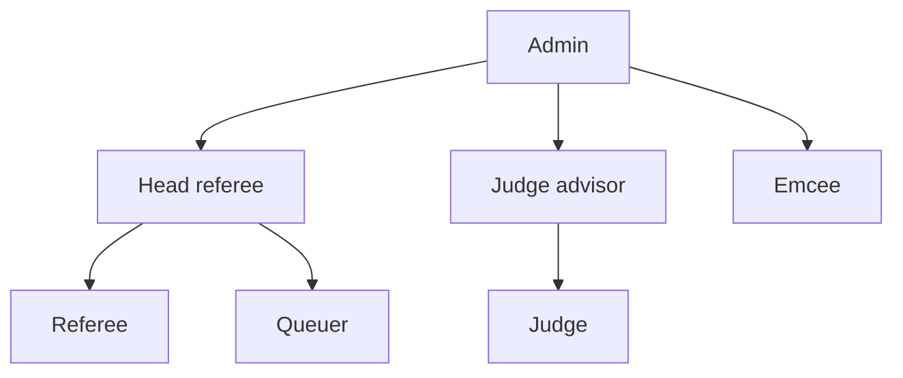

# Roles at a glance

Every TMS account has one or more roles. A role decides which screens appear on the home screen and in the side menu, and what the server will accept from that account.

## Which guide should I read?

| If you are... | Read |
| --- | --- |
| Setting up the server and the event | [Event administrator](event-admin.md) |
| Running matches and the timer | [Head referee](head-referee.md) |
| Scoring at a table | [Referee](referee.md) |
| Getting teams to their tables on time | [Queuer](queuer.md) |
| Announcing matches | [Emcee](emcee.md) |
| Looking after teams, judging and results | [Judge advisor](judge-advisor.md) |
| Judging teams | [Judge](judge.md) |
| Looking after the venue screens and sound | [Screen and AV operator](av-operator.md) |

## What each role can open

| Screen | Admin | Head referee | Referee | Queuer | Emcee | Judge advisor | No login |
| --- | :---: | :---: | :---: | :---: | :---: | :---: | :---: |
| Scoreboard | :material-check: | :material-check: | :material-check: | :material-check: | :material-check: | :material-check: | :material-check: |
| Timer | :material-check: | :material-check: | :material-check: | :material-check: | :material-check: | :material-check: | :material-check: |
| Referee Scoring | :material-check: | :material-check: | :material-check: | | | | |
| Match Controller | :material-check: | :material-check: | | | | | |
| Matches | :material-check: | :material-check: | | | | | |
| Tables | :material-check: | :material-check: | | | | | |
| Match Announcer | :material-check: | :material-check: | | | :material-check: | | |
| Queueing | :material-check: | :material-check: | | :material-check: | | | |
| Teams | :material-check: | | | | | :material-check: | |
| Team Data | :material-check: | | | | | :material-check: | |
| Judging Sessions | :material-check: | | | | | :material-check: | |
| Pods | :material-check: | | | | | :material-check: | |
| Setup | :material-check: | | | | | | |
| Dashboard | :material-check: | | | | | | |
| Users | :material-check: | | | | | | |
| Backups | :material-check: | | | | | | |

## How roles combine

- **Admin** can do everything.
- **Head referee** includes everything a **referee** and a **queuer** can do.
- **Judge advisor** includes everything a **judge** can do.
- An account can hold several roles at once. For example, a head referee who also announces can be given the emcee role too.

## Who can change what

| Action | Role required |
| --- | --- |
| Submit a scoresheet | Referee |
| Edit or delete a scoresheet | Judge advisor |
| Load, ready and edit matches | Head referee |
| Start the timer | Head referee or emcee |
| Stop (abort) the timer | Head referee |
| Add or remove tables | Head referee |
| Check a team in | Queuer |
| Add, edit or remove teams | Judge advisor |
| Edit judging sessions and pods | Judge advisor |
| Event setup, users and backups | Admin |

!!! note "Roles without their own screens"
    Accounts can also be given the **judge** role. It currently has no screens of its own beyond the public ones; see the [Judge](judge.md) page.

Accounts are created by the event administrator. See [Users and passwords](../admin/users.md).
