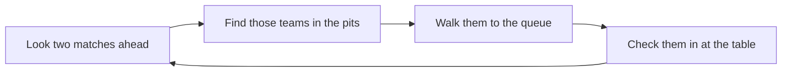

# I am a queuer

You make sure the right teams are at the right tables at the right time. TMS shows you what is coming up and lets you record which teams have arrived, so the head referee knows when a match can start.

!!! abstract "Your screen"
    **Queueing**. It is designed to work on a phone as well as a tablet.

## The queueing screen

The screen is a list of matches in schedule order. Each match is a card showing:

- the **match number** and **start time**, and
- each **table** in the match with the **team** due on it.

Cards change appearance as the day moves on:

- the match that the head referee has **loaded** is highlighted, because those are the teams you need at the tables now, and
- **completed** matches are shown as done.

## Checking a team in

Tap a team on a match card to change its check-in status. Each tap moves it to the next state.

| Status | Colour | Meaning |
| --- | --- | --- |
| Not checked in | None | The team has not arrived at the table |
| Checked in | Green | The team is at the table and ready |
| Not playing | Orange | The team will not play this match |

When a match is loaded and a team in it is still not checked in, the card draws your attention to it. Those are the teams to go and find.

!!! tip
    Mark a team as **not playing** as soon as you know they will not make it. It tells the head referee not to wait, and the referee at that table can record a no-show.

## A good rhythm

1. Work **ahead** of the loaded match. By the time a match is loaded its teams should already be queued.
2. Check teams in as they reach their table, not when you find them in the pits.
3. If a team cannot be found, tell the head referee early. They can reschedule the team to a later match.

## Common situations

??? question "The schedule on my screen changed"
    The head referee has edited a match. Your screen always shows the live schedule, so follow what it shows now.

??? question "A team says they are on a different table"
    Trust the screen. If the team has been told otherwise by the head referee, the head referee needs to update the match so the referees see the same thing.

??? question "I tapped the wrong team"
    Tap it again until it shows the right status.
