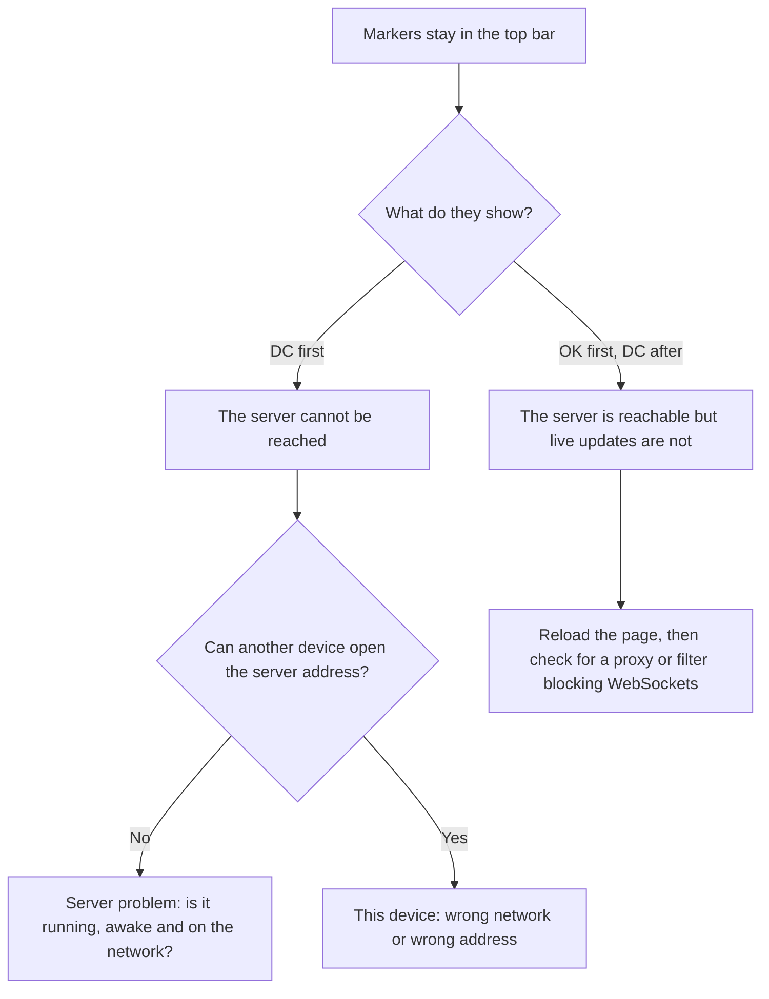

# Troubleshooting

Start with the symptom you can see. If you are at an event right now, the first two sections cover most problems.

## First checks

Before anything else:

1. Is the **server window still open** on the server computer, and has that computer gone to sleep?
2. Is the device on the **same network** as the server?
3. Has the **server's address** changed since the morning?
4. Does **reloading the page** fix it?

## The device will not connect

The top bar shows connection markers such as `[DC|DC|DC]` and they do not clear.

??? failure "`[DC|DC|DC]` on one device"
    That device cannot reach the server.

    - Check it is on the event Wi-Fi and not a guest or mobile network.
    - Open the connection page (cog icon) and check the **Server IP Address** and **Server Port**. Enter the right ones and select **Connect**.
    - In a browser, make sure the address begins with `http://` unless the server was started with `--tls`.

??? failure "`[DC|DC|DC]` on every device"
    The server is not reachable by anyone.

    - Look at the server computer. Is `tms_server` still running? If the window has closed, start it again; no data is lost.
    - Has the computer gone to sleep, or disconnected from the network?
    - Has its IP address changed? The server prints its address when it starts. See [Give the server a fixed address](../admin/networking.md#give-the-server-a-fixed-address).
    - Is a firewall blocking the port? See [Firewalls](../admin/networking.md#firewalls).

??? failure "`[OK|DC|DC]` or `[OK|OK|DC]`"
    The server answers, but the live connection does not stay up.

    - Reload the page.
    - Some school and corporate networks block WebSocket connections. Try the device on your own router.
    - If the server was restarted, devices reconnect by themselves within a few seconds.

??? failure "It works on the server computer but not on other devices"
    This is nearly always the firewall on the server computer, or **client isolation** on the Wi-Fi. See [Network planning](../admin/networking.md).

??? failure "The browser warns that the connection is not private"
    The server is running with `--tls` and a self-signed certificate. Choose to continue. See [Self-signed certificates](../admin/server-options.md#self-signed-certificates-and-browser-warnings).

## Logging in

??? failure "Incorrect Username or Password"
    Usernames and passwords are case sensitive. The default accounts use the username as the password. An admin can reset a password on the **Users** page.

??? failure "I have forgotten the admin password"
    There is no reset from the login page. Options:

    - If another admin account exists, log in with it and set the password in **Setup**.
    - Otherwise, restore a backup taken before the password was changed. See [Backups and restore](../admin/backups.md).

??? failure "A screen I need is not on my home screen"
    Your account does not have the role for it. See [Roles at a glance](../roles/index.md) and ask an admin to update your account. Log out and in again afterwards.

## Scoring

??? failure "Submit is blocked with a red message under a question"
    The scoresheet has an answer that breaks a rule of the game. Read the message and fix that answer. See [When the sheet will not submit](../roles/referee.md#when-the-sheet-will-not-submit).

??? failure "Comment Required"
    Gracious Professionalism is set to something other than *3 - Accomplished*. Enter a private comment and submit again.

??? failure "No team or the wrong team on the scoring screen"
    - Check the **table** selected in the header.
    - If no match is loaded, there is no team to show. Wait for the head referee.
    - If the previous scoresheet has not been submitted, submit or clear it.

??? failure "A scoresheet was rejected by the server"
    The server runs the same checks as the tablet. A rejection means the answers are invalid or the team number is not in the event. The message says which. If the team is missing, the judge advisor adds it on the **Teams** page.

??? failure "A score is wrong after it was submitted"
    The judge advisor corrects or deletes it on the team's page. See [Correcting a scoresheet](../roles/judge-advisor.md#correcting-a-scoresheet).

??? failure "The scoreboard shows Conflict"
    A team has two scoresheets for one round. See [Conflicting scores](../guides/scoring.md#conflicting-scores).

??? failure "The scoresheet shows the wrong season"
    An admin sets the season in **Setup → Season Setup**. See [Seasons and games](../guides/seasons.md).

## Matches and the timer

??? failure "Start and Countdown are greyed out"
    A match must be **loaded** and **ready** first. See [Running a match](../roles/head-referee.md#running-a-match).

??? failure "A table shows SIG or STBY"
    See [Table status](../roles/head-referee.md#table-status). `SIG` means no tablet is scoring on that table; `STBY` means the tablet has not caught up to this match.

??? failure "The timer was started by mistake"
    The head referee selects **Abort**. The match is not marked complete.

??? failure "There is no sound"
    Browsers block sound until someone has interacted with the page. On the device that should be heard, click on the page once, then check the volume, the output device and that the tab is not muted. See [Where the timer appears](../guides/timer.md#where-the-timer-appears).

??? failure "The sounds play twice"
    Two devices with a sound-playing screen (Timer, Match Controller, Match Announcer or Dashboard) are both audible. Mute all but one.

??? failure "A match will not show as complete"
    A match is completed by the timer running to zero. If it was played without the timer, the head referee can tick **Completed** in the match editor.

## Schedule

??? failure "The schedule will not import"
    See [If the import fails](../guides/schedule.md#if-the-import-fails).

??? failure "There are integrity messages after importing"
    The schedule itself has a problem, such as a team with no judging session. Look up the code in [Integrity checks](../guides/integrity.md).

## The server

??? failure "The server closes immediately when started"
    - Start it **from its own folder**. It needs the `log_config` and `tms_client` folders beside it.
    - Check another program is not already using the port. Try `--port 8081`.
    - Run it from a terminal so that you can read the message it prints.

??? failure "The server stopped during a restore"
    The backup file could not be loaded. Start the server again and restore a different backup.

??? failure "The web page is blank"
    The `tms_client` folder is missing or incomplete next to the server program. Unpack the release again.

## Still stuck?

Collect the following and [open an issue](https://github.com/CJBuchel/TMS/issues):

- the TMS version, from the connection page,
- what you did and what happened, and
- the log files from the time of the problem. See [Logs and files](logs.md).
